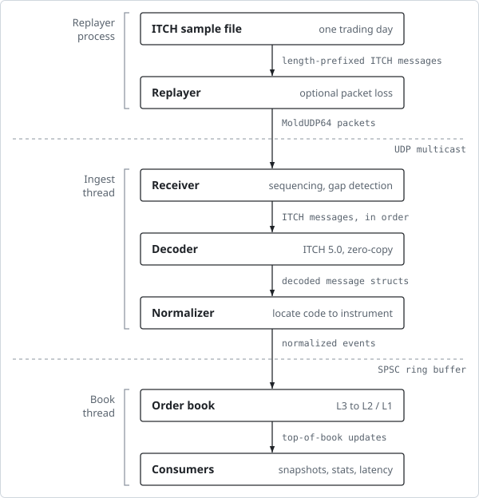

# itch-feed-handler

A low-latency market data feed handler in C++23. It replays a real Nasdaq trading day over UDP multicast, decodes the binary TotalView-ITCH 5.0 protocol, normalizes every message into a venue-neutral event format, and builds per-instrument order books in real time.

> **Status:** under active development. The roadmap below shows what is done and what is next. Performance numbers will be published in [`docs/perf.md`](docs/perf.md) once they are measured, not before.

## Why

Exchanges publish market data as dense binary streams of individual order events: adds, executions, cancels, replaces. Every trading system needs an adapter that turns that stream into something a strategy can use, quickly and without ever getting the book wrong. Nasdaq ITCH is the classic example of such a feed: it is order-by-order, big-endian, sequenced, and delivered over UDP multicast, and Nasdaq publishes real sample days for free. Building a handler for it touches binary decoding, network protocols, data structure design, and latency engineering all at once.

## Architecture



| Stage | What it does |
| --- | --- |
| **Replayer** | Reads a Nasdaq ITCH 5.0 sample file, wraps messages in MoldUDP64 packets, and multicasts them on loopback. Can drop a configurable fraction of packets to simulate loss. |
| **Receiver** | Joins the multicast group, unpacks MoldUDP64, tracks sequence numbers, and reports every gap. |
| **Decoder** | Zero-copy parsing of ITCH messages (S, R, A, F, E, C, X, D, U, P) from raw bytes into plain structs, using `memcpy`/`std::bit_cast` and `std::byteswap` rather than pointer casts. |
| **Normalizer** | Maps ITCH stock locate codes to internal instrument IDs, converts Price(4) to fixed-point integers, and emits venue-neutral events. |
| **Order book** | Tracks every resting order by reference number, aggregates price levels per side, and emits top-of-book updates. Debug builds check invariants (no negative quantity, no orphan orders, uncrossed book during continuous trading). |

### Internal event format

Downstream code never sees ITCH. It sees one compact, exchange-agnostic event type, designed so that a second venue could map onto it without changes. The full spec lives in [`docs/format.md`](docs/format.md).

| Field | Type | Notes |
| --- | --- | --- |
| `instrument_id` | `uint32` | Venue-neutral ID, mapped from ITCH's daily stock locate code |
| `exchange_ts_ns` | `uint64` | Exchange timestamp in nanoseconds |
| `receive_ts_ns` | `uint64` | When this process saw the packet; used for latency measurement |
| `seq` | `uint64` | Feed sequence number, for gap detection |
| `event_type` | `enum` | Add, Modify, Delete, Trade, Status, Definition |
| `order_id` | `uint64` | Exchange order reference number |
| `side` | `enum` | Buy or sell |
| `price` | `int64` | Fixed point; never a floating-point value |
| `qty` | `uint32` | Shares |

## Design principles

- **No allocation and no exceptions on the hot path.** Memory is pre-sized; per-instrument state lives in flat arrays indexed by locate code.
- **Wire fields are fixed-width integers.** Prices are fixed point end to end.
- **Measure before optimizing.** Every optimization comes with a hypothesis, a benchmark, and a before/after number, reported as percentiles (p50, p99, p99.9), not averages.
- **Correctness is checked, not assumed.** Message counts are cross-checked against an independent parser, book state after network replay must match book state after file replay, and the decoder is fuzzed.

## Repository layout

```
src/net/         sockets and MoldUDP64 framing
src/itch/        ITCH 5.0 decoder and message structs
src/normalize/   internal event format and the ITCH mapping
src/book/        order book
tools/           replayer, stats, book snapshot
tests/           unit, golden-file, and integration tests
bench/           Google Benchmark microbenchmarks
fuzz/            libFuzzer targets
docs/            format spec, design doc, performance report
```

## Building

Requires Linux (multicast and `perf` behave best there; WSL2 works), a C++23 compiler (GCC 14+ or Clang 18+), CMake, and Ninja. GoogleTest and Google Benchmark are fetched by CMake.

```sh
cmake -S . -B build -G Ninja -DCMAKE_BUILD_TYPE=Release
cmake --build build
ctest --test-dir build
```

Sanitizer build:

```sh
cmake -S . -B build-asan -G Ninja -DCMAKE_BUILD_TYPE=Debug -DENABLE_SANITIZERS=ON
cmake --build build-asan && ctest --test-dir build-asan
```

## Getting sample data

Nasdaq publishes free ITCH 5.0 sample days at [emi.nasdaq.com/ITCH](https://emi.nasdaq.com/ITCH/). Full Nasdaq days are several gigabytes; a BX or PSX day is a good place to start. Data files are not committed to this repo.

## Testing and quality

- **Unit tests** built from hand-written byte arrays, including truncated and unknown messages
- **Golden-file tests** that normalize a fixed slice of a real day and compare against checked-in output
- **Integration test** asserting that network replay and file replay produce identical books
- **Fuzzing** of the decoder with libFuzzer
- **CI** blocks merges on build, tests, AddressSanitizer, UndefinedBehaviorSanitizer, clang-tidy, and clang-format

## Roadmap

- [ ] Project setup, CI with sanitizers and linting, hex-dump tool
- [ ] ITCH file reader and message decoders, message-count `stats` tool
- [ ] Internal event format and normalizer, golden-file tests
- [ ] Order book builder with invariant checks and a snapshot tool
- [ ] MoldUDP64 replayer and receiver with gap detection
- [ ] Benchmarks, latency histogram, allocation-free hot path, SPSC queue
- [ ] Fuzzing, runtime counters (messages/sec, gaps, decode errors, queue depth)
- [ ] Design doc

Possible extensions afterwards: a second, structurally different feed (for example a price-level feed) to validate the internal format, gap recovery via snapshots and retransmit requests, A/B feed arbitration, and CPU pinning and busy-polling experiments measured against the baseline.

## References

- [Nasdaq TotalView-ITCH 5.0 specification](https://nasdaqtrader.com/content/technicalsupport/specifications/dataproducts/NQTVITCHspecification.pdf)
- MoldUDP64 and SoupBinTCP specifications, available on nasdaqtrader.com
- Carl Cook, "When a Microsecond Is an Eternity", CppCon 2017
- David Gross, "When Nanoseconds Matter", CppCon 2024

## License

[MIT](LICENSE)
